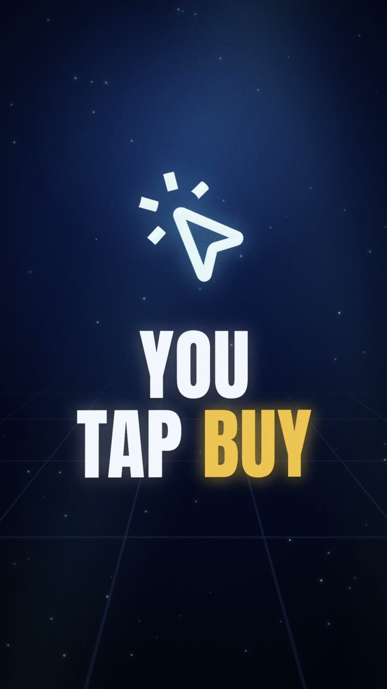
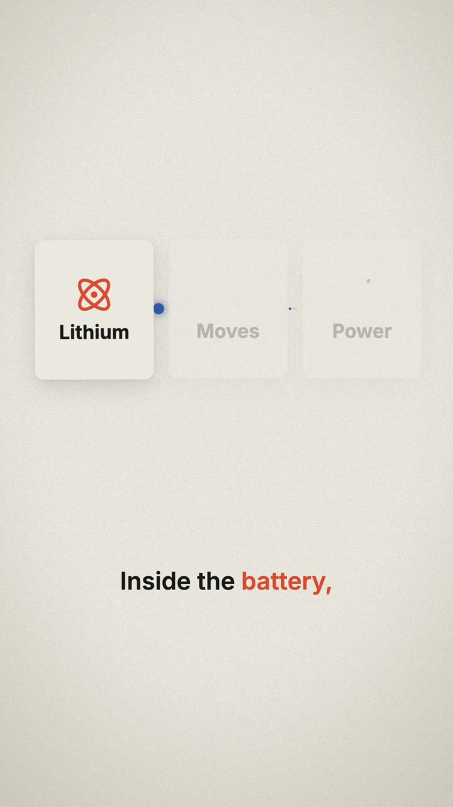
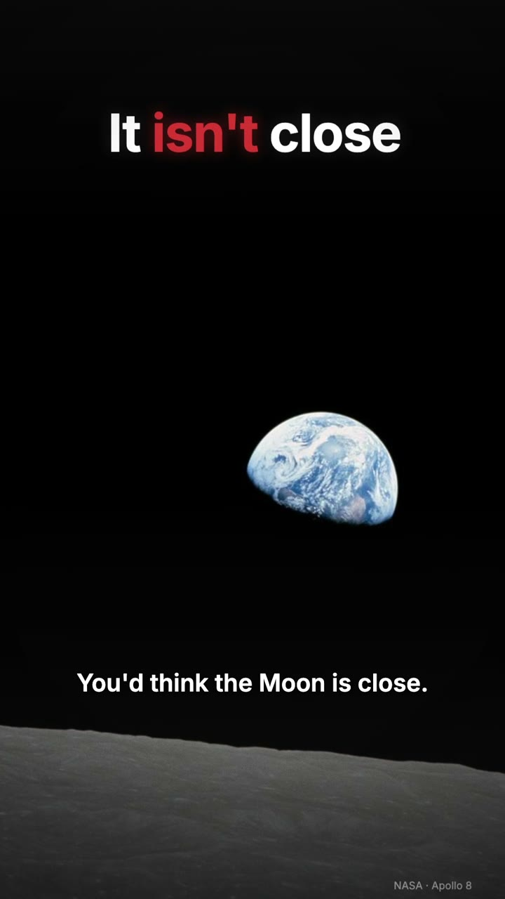

# Tradient Video Engine

Give it a topic; get a finished vertical video. It researches the facts, writes a script that sounds
spoken, records the voice, builds a visual for every line, adds music and sound effects, renders, and
checks the file before handing it over. In the house style, in your own brand style, or in a style it
learns from examples you give it.

| 1 · House style | 2 · Your own style | 3 · Trained from examples |
|---|---|---|
| [](examples/house.mp4) | [](examples/paper.mp4) | [](examples/mission.mp4) |
| Luminous 3D: the engine's own look. [Video](examples/house.mp4) · [scenes](examples/house-scenes.jpg) | "Paper", made from a brand card in one command. [Video](examples/paper.mp4) · [scenes](examples/paper-scenes.jpg) | "Mission", learned from 5 NASA photos, a NASA video and nasa.gov. [Video](examples/mission.mp4) · [what it learned](styles/mission/card.jpg) |

## Start

1. Install [Node.js](https://nodejs.org) 20 or newer.
2. Get the engine and set it up:
   ```sh
   git clone --depth 1 https://github.com/stefanocolmant/tradient-video-engine.git
   cd tradient-video-engine
   npm run setup
   ```
3. Open the folder in **Claude Code** (or Codex) and ask **"How do I run it?"**

The agent checks the setup, shows the three styles, and from there you just talk to it:

> "Make a 40-second video about why the stock market closes at 4pm, house style."
> "Build my style: black background, lime accent, Space Grotesk, energetic."
> "Learn the style of these: three screenshots in styles/_inbox/acme/, and acme.com."

Want to look first? `npm run gallery` opens [START-HERE.html](START-HERE.html).

## The three styles

1. **House style.** A deep navy world with glowing 3D objects, glass panels and condensed titles.
2. **Your own style.** Colours, fonts (any Google Font), logo and a mood (calm, confident, energetic,
   playful, luxury, techy): `npm run style:new -- acme --bg "#0E1116" --accent "#FF6B00" --mood energetic`.
3. **Train a style.** Put pictures, videos and a `links.txt` of websites in `styles/_inbox/<name>/` and
   run `npm run style:learn -- <name>`. It measures palette, light, texture, the websites' real fonts and
   colours, and the videos' editing rhythm; the agent adds what the eye sees, then `style:test` renders
   the look next to your references with a match score. [How it works](docs/TRAIN_A_STYLE.md).

`clean` and `bold` are two more starting points. Every style works with every video:
change one word in the storyboard to re-render a video in another look.

## How a video is made

```
brief -> facts (with sources) -> script ✓ -> voice + word timings -> storyboard ✓ -> stills -> render + sound -> QA ✓
```

Each ✓ is a gate that must pass:

- **Script check:** length for the target duration, a hook in the first line, short spoken sentences,
  no AI cliches or dashes, nothing the voice will misread, a source for every number. [Rules](docs/SCRIPT.md)
- **Storyboard check:** every scene starts on a phrase that is really said, text fits, icons and files
  exist, shots vary, every sentence gets its own visual, every number on screen is sourced. [Rules](docs/STORYBOARD.md)
- **QA on the real file:** decodes cleanly, right size and length, -14 LUFS loudness with peaks under
  -1 dBTP, no black, frozen or flashing frames, the hook visible in frame one, nothing the renderer
  flagged; plus a review sheet of real frames to look at. [Checks](docs/QA.md)

16 scene types (titles, counting numbers, lists, comparisons, charts, flows, timelines, quotes, photos
and screenshots with callouts, 3D hero objects, proportion grids, before/after, a 3D globe or dotted
map, a phone, an end card) plus custom scenes in code. [Scene reference](docs/SCENES.md)

## Voices

Free and local out of the box (Kokoro). Add `ELEVENLABS_API_KEY` or `OPENAI_API_KEY` to `.env` for
premium voices, or record your own. Every voice is transcribed back and checked word by word when a
speech recogniser is available. [Voice guide](docs/VOICE.md)

## Commands

| | |
|---|---|
| `npm run setup` · `npm run doctor` | install everything · check what's ready |
| `npm run new -- my-video --style house` | start a video folder |
| `npm run make -- my-video` | script check → voice → storyboard check → stills → render → QA |
| `npm run style:new` · `style:learn` · `style:test` | your own style · train a style · test a style |
| `npm run styles` · `npm run icons -- <word>` · `npm run grab -- <url> <video>` | list styles · find icons · screenshot a page |
| `npm run preview -- my-video` | live preview in Remotion Studio |
| `npm test` | engine self-test |

Full workflow for agents: [AGENTS.md](AGENTS.md). Setup details: [docs/SETUP.md](docs/SETUP.md).
Problems: [docs/TROUBLESHOOTING.md](docs/TROUBLESHOOTING.md).

## Inside

| folder | |
|---|---|
| `videos/` | one folder per video: brief, facts, script, voice, storyboard, assets, renders (`out/`) |
| `styles/` | one folder per style: `style.json`, notes, fonts, card; trained styles keep their references |
| `examples/` | the three example videos above |
| `src/` | the renderer (React + Remotion + three.js): scenes, captions, transitions, backgrounds |
| `tools/` | the commands: checks, voice, mixing, rendering, QA, style tools |
| `docs/` | the rules and guides |
| `public/` | fonts, sound effects, music beds, textures |

## Licences

Code: MIT. Remotion (the renderer) is free for individuals and teams of up to 3; larger companies need
a Remotion company licence. Fonts are open-licensed; sounds and music are original; example photos and
frames are NASA public domain. Details: [licenses/THIRD-PARTY.md](licenses/THIRD-PARTY.md).

Version 2.0. Version 1 (the V8 film, A23 replay and CStack engines) is kept at tag `v1.0.0`.
